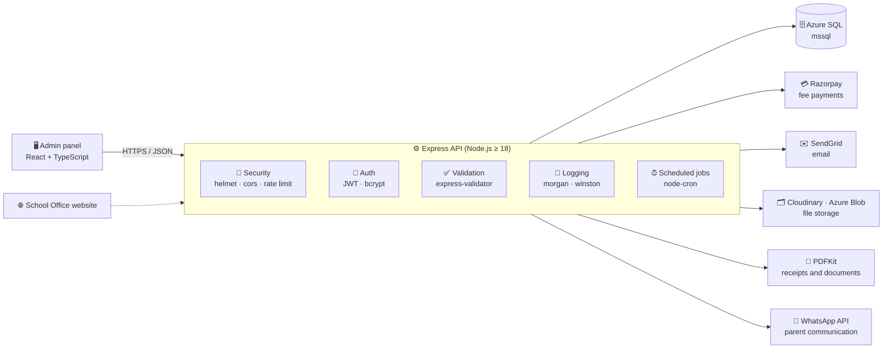
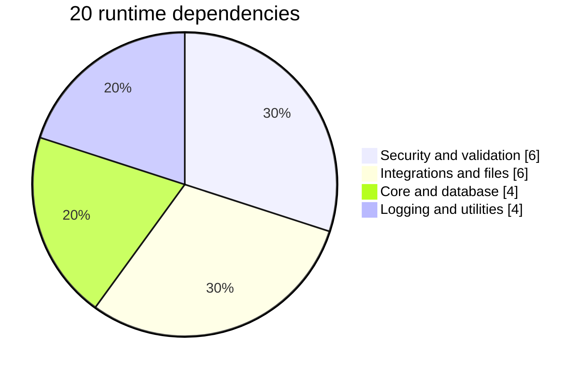

<p align="center">
  
</p>

<p align="center">
  
  
  
  
  <a href="https://www.schooloffice.tech"></a>
</p>

## 🏫 About

This is the backend of **[School Office](https://www.schooloffice.tech)**, a school management ERP for K-12 schools. It is a REST API built with **Node.js and Express** on top of **Azure SQL (SQL Server)**. It handles authentication, school data, fee payments, document generation, email, file storage, scheduled jobs and parent communication through a WhatsApp API.

The admin panel that talks to this API lives in **[schoolOfficeAdminFront](https://github.com/Muniramm890/schoolOfficeAdminFront)**.

## 🧱 Architecture



## 🧰 Tech stack

| Layer | Technology | Used for |
| :-- | :-- | :-- |
| Runtime | Node.js ≥ 18 | Server runtime |
| Framework | Express 4 | REST API, routing |
| Database | Azure SQL via `mssql` | Primary data store |
| Auth | `jsonwebtoken`, `bcryptjs` | Token auth and password hashing |
| Security | `helmet`, `cors`, `express-rate-limit` | Secure headers, CORS, rate limiting |
| Validation | `express-validator` | Request validation |
| Payments | `razorpay` | Fee collection |
| Documents | `pdfkit` | PDF generation |
| Email | `@sendgrid/mail` | Transactional email |
| Files | `multer`, `cloudinary`, `@azure/storage-blob` | Uploads and storage |
| Jobs | `node-cron` | Scheduled tasks |
| Logging | `morgan`, `winston` | HTTP and application logs |
| Utilities | `dotenv`, `uuid`, `compression` | Config, IDs, response compression |

### 📊 Dependencies by purpose



## 📁 Project structure

```text
SCHOOL-ERP-backend/
├── .github/
│   └── workflows/        # GitHub Actions workflows
├── src/
│   ├── server.js         # Application entry point
│   ├── utils/
│   │   └── migrate.js    # Database migration script (npm run migrate)
│   └── …                 # Remaining application source
├── .gitignore
├── package.json          # Scripts and dependencies
└── web.config            # IIS / Azure App Service (Windows) configuration
```

## 🚀 Getting started

**Requirements:** Node.js 18 or newer, and access to an Azure SQL / SQL Server database.

```bash
# 1. Clone
git clone https://github.com/Muniramm890/SCHOOL-ERP-backend.git
cd SCHOOL-ERP-backend

# 2. Install dependencies
npm install

# 3. Create a .env file with your configuration (loaded with dotenv)

# 4. Run database migrations
npm run migrate

# 5. Start the server
npm run dev     # development, auto-reload with nodemon
npm start       # production
```

| Script | What it does |
| :-- | :-- |
| `npm run dev` | Runs `src/server.js` with nodemon |
| `npm start` | Runs `src/server.js` with Node |
| `npm run migrate` | Runs `src/utils/migrate.js` |

## 🔒 Configuration and security

- Secrets such as database credentials, JWT secret and API keys are kept in a `.env` file, which is listed in `.gitignore` and never committed.
- The API uses secure HTTP headers, CORS rules and rate limiting, passwords are hashed with bcrypt, and requests are validated before they reach the database.

## 🔗 Related repositories

| Repository | Purpose |
| :-- | :-- |
| [schoolOfficeAdminFront](https://github.com/Muniramm890/schoolOfficeAdminFront) | React + TypeScript admin panel |
| [SchoolOffice](https://github.com/Muniramm890/SchoolOffice) | Product website |

## 📬 Contact

- 🌐 Website: [schooloffice.tech](https://www.schooloffice.tech)
- 📧 Email: [Head@schooloffice.tech](mailto:Head@schooloffice.tech)
- 👤 Developer: [Muni Ram Meena](https://github.com/Muniramm890)

<p align="center">
  
</p>
